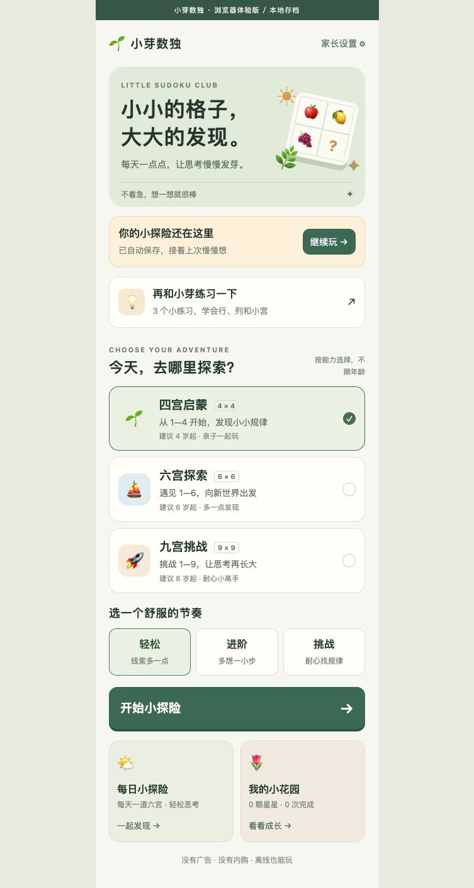

# 小芽数独 🌱

面向幼儿和儿童的原生微信小程序。以“观察 → 尝试 → 发现”为主线，从水果四宫开始，逐步探索六宫和九宫。不依赖服务器、账号、云开发或第三方 npm 包。



## 立即运行

1. 打开微信开发者工具，选择 **导入项目**。
2. 目录选择本文件所在的 **little-sudoku**，而不是上一级 games。
3. 项目类型选择“小程序”。仓库默认 `touristappid`，可选择测试号/无 AppID 进行本地体验；若当前开发者工具要求 AppID，请填入你自己的小程序 AppID。
4. 点击编译，入口为 `pages/index/index`，无需构建 npm。
5. 真机预览、上传和发布时，使用自己的小程序 AppID，并在微信公众平台完成适用的类目、隐私声明及审核流程。项目尚未上传或发布。

项目配置采用微信原生目录结构，可参考 [微信开发者工具项目配置文档](https://developers.weixin.qq.com/miniprogram/dev/devtools/projectconfig.html) 和 [微信官方示例](https://github.com/wechat-miniprogram/miniprogram-demo)。

### 先用浏览器体验

安装 Node.js 18 或更高版本后，在此目录执行：

```sh
npm run preview
```

打开 <http://127.0.0.1:4173>。浏览器预览复用原版 WXML、WXSS、出题引擎和页面逻辑，通过轻量适配器运行，并非独立写一套演示界面。浏览器存档和微信存档互相独立。浏览器体验不能代替微信真机测试，振动和分享等能力以微信为准。仅绑定本机地址，不对外开放服务。

## 已实现的功能

- **三种尺寸、三档难度**：4×4（2×2 宫）、6×6（2×3 宫）、9×9（3×3 宫）。所有模式直接开放，年龄仅为参考。
- **三步互动教学**：依次观察行、列、小宫，选出缺失答案；答对后才进入下一步。规则、工具和星星说明可随时重看，进入教学不覆盖游戏存档。
- **持续出题**：随机完整盘面、随机挖空；挖空时计数解的数量，确保唯一解。轻松模式额外验证可用唯一候选和区域唯一位置逐步完成。进阶和挑战主要增加空格，未承诺专业赛事难度或所有高级技巧。
- **两种显示方式**：水果图案与数字，映射固定，适合从图案认知过渡到数字。
- **完整操作**：选格、同行同列同宫高亮、相同值高亮、线索保护、答案填写、候选笔记、擦除、最近 100 步撤回、检查、可关闭的重复提醒。
- **解释型提示**：先引导排查已填错格；优先解释唯一候选或区域唯一位置，没有简单推理时明确告知直接帮填。帮填需要主动点击，提示不设次数上限。
- **自动保存**：每次落子和操作、离开游戏、切到后台时保存；探索时长每 15 秒保存。计时仅记录前台游戏时间，没有倒计时、生命值或失败锁定。
- **每日挑战**：按设备本地日期生成固定的六宫轻松题，同一天所有设备使用同一题种子；一天奖励一次，可以反复练习。
- **成长花园**：累计星星解锁 6 个成长图鉴，记录各尺寸完成次数与连续探索天数。
- **家长设置**：显示模式、温柔提醒、轻触振动、本地清除确认，以及陪伴建议和数据说明。

### 奖励规则

普通通关 3 星；使用过帮填提示减 1 星，使用“检查”发现过错误再减 1 星，至少 1 星。输入试错本身不扣星。撤回不会退还提示使用记录。同一天重复完成每日题不重复计数或奖励。星星只是累计成长记录，不消耗、不购买。

## 数据与边界

全部数据只保存在当前设备的微信本地存储：一个未完成存档、设置、完成统计、每日领奖日期。无需联网，无广告、无内购、无身份或位置采集。切换新局会明确提示替换现有存档；尚不支持多设备同步、多存档和云备份。清理应用数据、卸载或换机可能丢失进度；存储写入失败时游戏界面会显示提醒。

水果使用系统 Emoji，外观会随设备字体变化；九宫适合数字模式，幼儿推荐四宫。页面可滚动，小屏手机不需要把整盘与全部工具强行压缩到一屏。

## 验证

```sh
npm test
```

使用 Node 内置测试框架，无需安装依赖。覆盖 135 道不同尺寸与难度的题目、唯一解、六宫矩形宫规则、轻松模式推理、题目多样性、日期与每日奖励、教学、笔记、撤回、线索保护、存档恢复、星星幂等和存储错误。

已在当前环境通过 20 项自动化测试，并使用已安装微信开发者工具的 WXML / WXSS 编译器通过语法编译；浏览器走查已验证三步教学、开始游戏和提示帮填。尚未完成微信真机验收。建议正式发布前在开发者工具与 iOS / Android 各验证一次下列流程：

- 教学三步 → 四宫通关 → 花园领奖 → 再来一题。
- 六宫、九宫的宫线、数字显示和笔记显示；小屏与大字体下可滚动操作。
- 填写 → 后台 → 重新进入 → 继续上次；确认前后台计时。
- 每日挑战重复完成不重复领奖；离线运行与清理记录确认。
- 切换图案/数字与提醒，设置在重启后保留；有真机权限时测试振动。

## 文件结构

```text
little-sudoku/
├── project.config.json       开发者工具导入配置
├── LICENSE                   MIT 开源许可证
├── miniprogram/
│   ├── app.js / app.json / app.wxss
│   ├── pages/index/          首页、课堂、游戏、花园、家长设置
│   └── utils/
│       ├── sudoku.js        随机题目、候选、求解、提示（纯逻辑）
│       └── storage.js       本地存档、奖励、日期
├── tests/                   引擎与页面行为测试
└── tools/                   无依赖浏览器预览服务器与适配器
```

调整文案与页面在 `pages/index/`，修改风格在 `app.wxss`；尺寸规则、难度目标挖空比例和提示在 `utils/sudoku.js`。题目实际空格数受唯一解约束，可能低于目标比例。代码不包含任何真实 AppID、密钥或服务端凭据。

## 开源许可与素材

项目代码和原创文档采用 [MIT License](LICENSE)，允许使用、修改、分发和商业使用，分发时需保留许可证中的版权与许可声明。`package.json` 的 `private: true` 用于防止误发布到 npm，不影响 GitHub 公开或 MIT 授权。

界面使用系统 Emoji 和 CSS 绘制元素，预览图是项目自身界面截图；仓库未附带第三方字体、图标包、音乐或图片素材。系统 Emoji 的具体外观由设备字体决定，项目的 MIT 许可不授予第三方字体或商标权利。

## 发布到 GitHub 前

建议把本目录内容作为独立仓库的根目录，保留本目录的 `.gitignore`。上一级 `games` 是包含其他项目的 Git 仓库；若只公开数独，请勿直接推送整个上级仓库及其历史。

提交前检查：

1. 运行 `npm test`，并通过 `git status --short`、`git diff --cached` 检查本次提交内容。
2. 保持共享的 `project.config.json` 使用 `touristappid`。需要真实 AppID 时，在本机开发者工具中配置，并检查它是否改写了共享配置。AppID 本身不是服务端密钥；AppSecret、上传私钥和访问令牌不可提交。
3. 确认不包含 `.env`、私钥、访问令牌、日志、用户存档或本机私人配置。`.gitignore` 已排除常见本地凭据；允许提交的 `.env.example` / `.env.*.example` 只能写占位值。
4. 如仓库已有历史提交，也要检查历史中是否出现过凭据。`.gitignore` 不会移除已跟踪文件或历史中的敏感内容；若曾泄露，先撤销或轮换相应凭据，再处理历史。

浏览器适配器会执行本仓库的 JavaScript 和 WXML 表达式，仅用于开发者信任源码的本地预览；不用于执行外部上传的模板，也不应直接作为公网服务部署。小程序本体不依赖这个适配器。

公开源码后仍需在微信开发者工具及真机验证兼容性。GitHub 公开仓库与微信小程序上线是独立步骤，仓库不包含任何上线账号或发布凭据。
